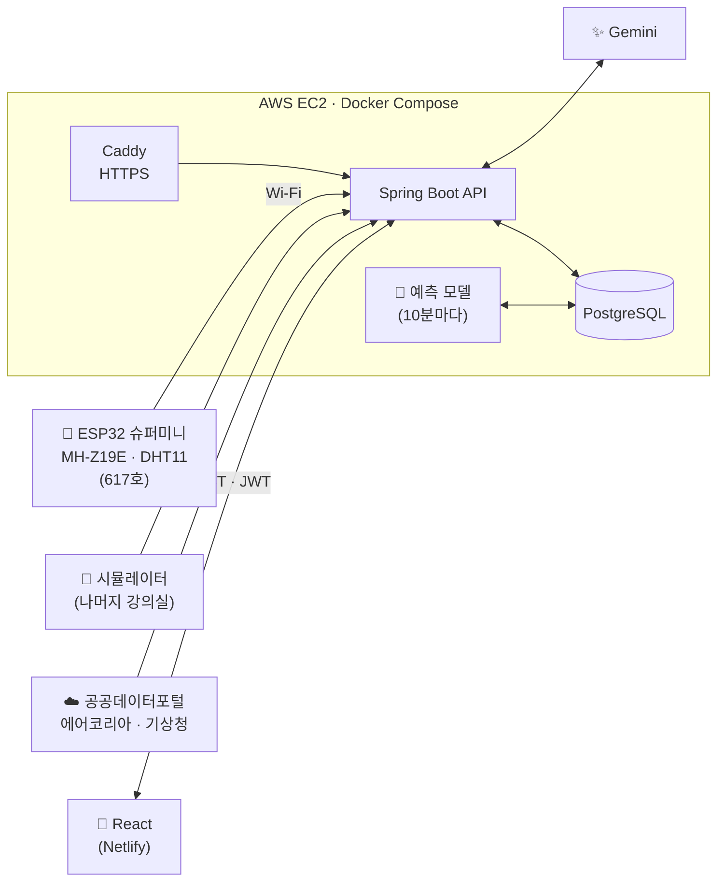

# 🌬️ 숨표 (Sumpyo)

**강의실 공기가 나빠지기 전에, 미리 알려주는 서비스**

센서와 수업 시간표로 강의실 CO₂를 예측하고, 
근로학생에게 "언제, 어디를, 어떻게" 환기할지 안내합니다.

 

## 📌 왜 만들었나요?

- 학교보건법의 강의실 CO₂ 기준은 **1,000ppm 이하**입니다.
- 북악관 617호에 센서를 달아 측정해 보니, 수업 중 CO₂가 **2,610ppm**까지 올라 다음 날 아침까지 기준을 넘었습니다.
- 하지만 강의실 안에 있는 사람은 이 변화를 잘 느끼지 못하고, 근로학생도 직접 들어가 보기 전엔 어느 강의실이 답답한지 알 수 없습니다.

> 그래서 **기준을 넘은 뒤가 아니라, 넘기 전에** 알려주는 서비스를 만들었습니다.

 

## ✨ 주요 기능

| 화면 | 설명 |
|---|---|
| 🏠 **홈 (수업 중 예보)** | 담당 강의실의 쾌적도(100점), CO₂·온도·습도, 바깥 기온·미세먼지를 보여주고 "520호 수업 전에 열어두세요"처럼 할 일을 카드로 안내 |
| 🗺️ **캠퍼스 현황** | 층별 평면도에서 기준 초과 강의실은 🔴, 30분 안에 초과가 예상되는 강의실은 🟡로 표시. 실측 + AI 예측 CO₂ 그래프 제공 |
| 📥 **접수함** | 민원 접수 당시의 CO₂·온도·습도를 함께 기록하고, AI가 "창문 2곳을 30분 열고 에어컨을 틀어주세요"처럼 조치를 추천 |
| 📱 **학생 QR 민원** | 로그인 없이 `답답해요` `더워요` `추워요` `습해요` `냄새나요` 중 골라 바로 접수 |
| 💬 **캠퍼스톡** | 근로학생끼리 건물·층·강의실별로 연락하고, 시간표와 센서값을 반영한 AI 추천 답변으로 빠르게 답장 |
| ⚙️ **설정·알림** | CO₂ 환기 기준(800 / 1,000 / 1,200), 미리 알림 시간(10·15·20분 전), 담당 구역 설정 |

 

## 🏗️ 시스템 구조

 

## 🤖 CO₂ 예측 모델

강의실 CO₂가 **쌓이고 빠지는 원리를 식으로 세우고**, 강의실마다 그 계수를 데이터로 학습합니다.

| 상황 | 5분마다 CO₂ 변화 |
|---|---|
| 수업 중 | 사람이 내뿜는 만큼 오르고(`a`), 바깥과의 차이만큼 빠짐(`b`) |
| 야간 | 바깥 농도를 향해 천천히 빠짐(`k`) |

- **학습**: 강의실별 최근 7일 데이터에 최소제곱법으로 `a`, `b`, `k`를 맞춤
- **예측**: 수업 시간표·휴강을 반영해 5분 단위로 **2시간 뒤**까지 예측
- **조치 생성**: 30분 안에 기준 초과가 예상되면 환기 조치를 만들고 담당 근로학생에게 알림
- **검증**: 30분 뒤 예측 오차(MAE)를 "현재 값 그대로 유지"와 비교

> 예측 모델 코드는 [Sumpyo-ML](https://github.com/Sumpyo-SKU/Sumpyo-ML) 레포에 있습니다.

 

## 🛠️ 기술 스택

| 분야 | 기술 |
|---|---|
| **Backend** | Java 21, Spring Boot 4.1, Spring Data JPA, Spring Security + JWT, Flyway, springdoc-openapi (Swagger) |
| **Database** | PostgreSQL 16 |
| **AI** | Python (pandas, NumPy), Gemini API |
| **Frontend** | React, Vite |
| **Infra** | AWS EC2, Docker, Docker Compose, Caddy, GitHub Actions, Netlify |
| **IoT** | ESP32 슈퍼미니, MH-Z19E (CO₂), DHT11 (온습도) |
| **Test** | JUnit 5, MockMvc, Testcontainers |
| **협업** | GitHub, Notion, Discord, Figma, ERDCloud |

 

## 📊 데이터 안내

- **실측**: 북악관 617호 (ESP32 + MH-Z19E + DHT11)
- **시뮬레이션**: 나머지 강의실은 617호 실측을 바탕으로 만든 시뮬레이션 데이터로 확장 시연합니다.

 

## 🔗 바로가기

- 서비스: https://sumpyo-sku.netlify.app
- API 문서 (Swagger): `<API 주소>/swagger-ui/index.html`
- 예측 모델: [Sumpyo-ML](https://github.com/Sumpyo-SKU/Sumpyo-ML)

 

## 👥 팀

| 이름  |    역할   |
|:---:|:-------:|
| 오지우 | Backend |
| 최서연 | Frontend |
| 김연성 |  Design |
| 배정훈 |    기획   |

 

**제2회 소프트웨어학과 × 전자컴퓨터공학과 프로그래밍 공모전**

